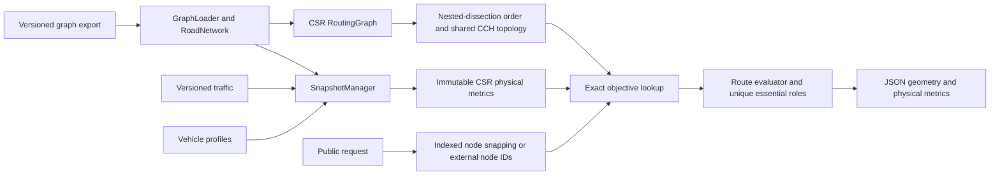

# Implemented architecture

The core has no FastAPI, Redis, PostGIS, ONNX or React dependency. External
services publish files or call the public C++ API. Directed and parallel arcs
remain distinct; external uint64 IDs are mapped into CSR internally. Database
row order is never used as metric order.

## Lifecycle and concurrency

An Engine owns an immutable graph, a balanced 3D unit-sphere node index, and a
shared immutable RoutingKit hierarchy. Profile metrics are prepared for each
traffic snapshot before atomic shared_ptr publication. A request captures one
MetricSnapshot and retains it throughout all objective queries and evaluation.
Old bundles remain alive while any request or bounded cache references them.
A failed preparation leaves the current snapshot usable.

Different traffic versions must have strictly increasing validity-start times.
Same-version identical publication is idempotent; changed same-version data is
rejected. Publishers must never reuse retired version identifiers. Snapshot
identity, rather than version text alone, protects the engine caches.

Each CCH adapter owns independent metric storage and one reusable query buffer.
A mutex serializes operations on that adapter. withWeights shares topology but
creates an independent metric/query; different adapters may query concurrently.
An atomic update-and-query operation supports the lower-level alternative API.
Separate updateWeights then shortestPath calls are individually safe but are
not a transaction together. Update customization uses replacement storage and
publishes only after success. Identical weights skip customization.

Engine caches are bounded LRU lists: at most six objective adapters and 64 route
responses by default. Objective identity is captured snapshot + profile + exact
double preference; the Engine's graph/config/profile definitions are immutable.
Response identity additionally includes resolved nodes, departure, route cap,
detour thresholds and snap distances. No nearby preference is substituted.
A traffic update clears caches; late in-flight insertions retain their old
snapshot identity and cannot satisfy a new-snapshot lookup. Zero disables each
cache. Profile metric preparation is O(profiles * arcs); profile count is capped
at 64. Cache caps are entry limits, not hard process-memory limits.

## Route behavior

The shared alternative generator evaluates 1.0, the exact selected double, and
0.0, deduplicates by original CSR arc sequence, and associates multiple roles and
objective scores with one physical route. Engine prefetch is disabled. Essential
routes survive detour checks and receive an advisory exceeds_detour_limit flag.
If max_routes is 1 or 2 the exact selected route is retained first; otherwise
ordering is fastest, selected, eco after deduplication. IDs are response-scoped.

RouteEvaluator validates endpoints, arc bounds, connectivity, finite/nonnegative
metrics and summation. Geometry follows each directed segment; missing geometry
falls back to node chords and is explicitly approximate. Source=self returns
zero metrics and GeoJSON Point, including isolated nodes by ID.

## Snapping v1 boundary

The k-d tree indexes unit-sphere coordinates, handling antimeridian and poles.
Great-circle distance is bounded by max_snap_distance_meters. Source/target
eligibility requires an outgoing/incoming non-self arc; ties use external node
ID. Equal input coordinates use Any eligibility for zero-length requests.
Eligibility does not prove connectivity. A disconnected nearest eligible pair
returns NoRoute; the engine does not silently pick a farther component.
No edge projection, partial-edge travel, heading or legal turn restrictions are
modeled. These are explicit v1 limitations, not correctness guarantees for
turn-by-turn navigation.

## Numerical policy

Let c(e) = alpha*time/Tref + (1-alpha)*CO2e/Gref. Integer weights round S*c(e),
preserving zero and promoting tiny positive values to one. The engine chooses
S no larger than the configured scale so a conservative simple-path bound stays
below RoutingKit infinity (2,147,483,647 in the installed dependency).
The bound uses min(sum of arc objectives, (n-1)*max objective) and reserves one
rounding unit per positive path arc. A shortest path can be simple for
nonnegative weights. Individual self-loops are separately bounded.

The effective scale and a conservative normalized-objective error bound are
returned per objective. A path's error is at most min(n-1,positive_arcs)/S;
integer-optimal versus real-optimal objective loss can be up to twice that bound.
This does not bound differences in unweighted travel time or emissions.
Unrepresentable scales/bounds fail with ResourceExhausted; weights are not
saturated. The legacy direct weight builder retains its strict fixed-scale
per-edge semantics. Direct CCH queries classify reachable over-range paths as
ResourceExhausted and disconnected topology as NoRoute. Dijkstra remains an
independent integer reference.

The slider is a normalized weighted objective, not a calibrated statement that
50% represents equal societal or scientific importance.

## Persistence and limits

Order caches bind version, exact CSR ordering and coordinates using a canonical
64-bit fingerprint and validated permutation. They are corruption guards, not
trusted signatures. Full serialized hierarchy persistence is deferred: the
measured ordering cost is larger than hierarchy construction and order caching
is a smaller portable first step. Graph changes require a new Engine. A single
Engine has no hard cancellation inside RoutingKit preprocessing/customization;
the Python process boundary enforces deadlines by terminating a worker.